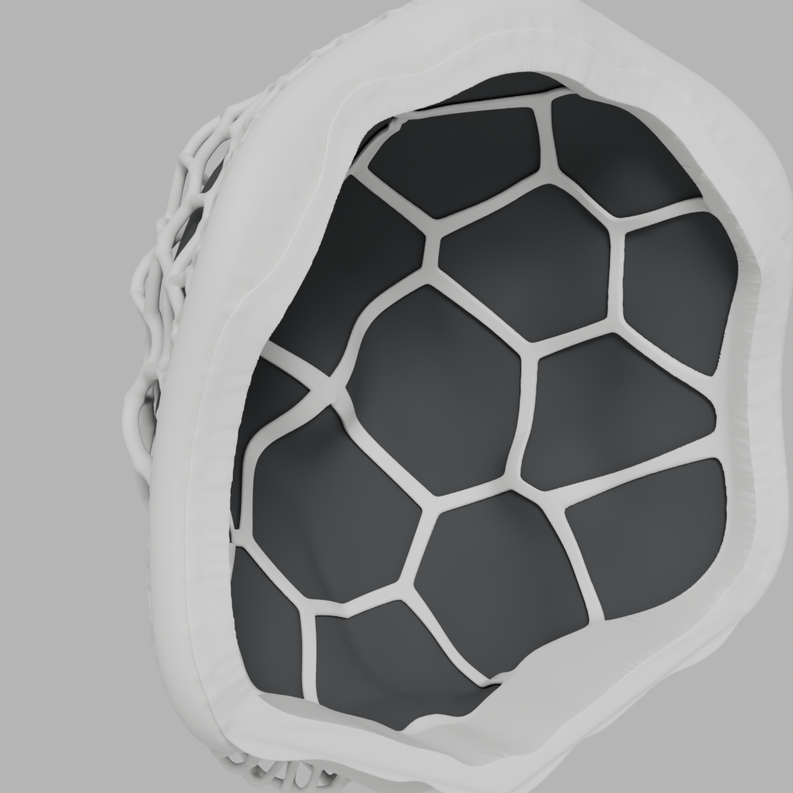
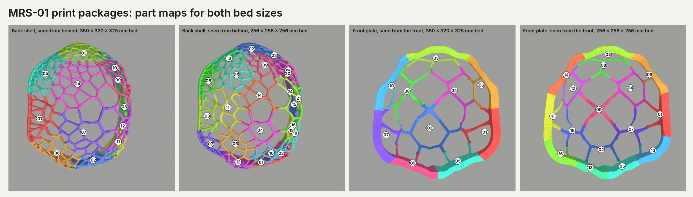

# MRS-01 Modular Recording Shell

A vocal shield for recording, to 3D print at home. An organic printed lattice forms the back shell. A 30 mm sheet of acoustic foam, cut from one flat piece, sits inside it. A printed front plate holds the foam in place and rests on the lip of the shell. The shell mounts on a standard 3/8" mic stand thread.



**Status: nothing in this repository has been printed or assembled yet.** All geometry is checked by computer only. Print two neighbouring parts and test the joint before you print a full set.

## Size

| Part | Width × depth × height | Material |
|---|---|---|
| Back shell | 800 × 494 × 865 mm | printed, about 6.0 l solid model volume |
| Front plate | 766 × 430 × 795 mm | printed, about 1.5 l solid model volume |
| Inlay | 746 × 446 × 784 mm formed, 1228 × 1144 mm flat | 30 mm soft acoustic foam or felt |

## Which files to print

The back shell and the front plate come split into parts, in three connection types and for two printer sizes. Pick one connection type and one bed size.

| Connection | How it works | Folder |
|---|---|---|
| Block pins | A rectangular pin on one part, a socket on the other, glued | [`print/block-pins/`](print/block-pins/) |
| Butterfly keys | Flat joint faces, a separate printed bow-tie key across each seam | [`print/butterfly-keys/`](print/butterfly-keys/) |
| Overlap | A stepped half-lap at each joint, about 10 mm, glued | [`print/overlap/`](print/overlap/) |

| Printer bed | Back shell | Front plate |
|---|---|---|
| 256 × 256 × 256 mm | 24 parts | 16 parts |
| 350 × 320 × 325 mm | 12 parts | 10 parts |

Every part is already turned into its print orientation. Each connection folder has its own README with print settings, the assembly order and a `parts.csv` per bed size.



## Repository layout

```
MRS-01/
├── README.md
├── CHANGELOG.md
├── print/
│   ├── block-pins/        README, docs/, bed-256/, bed-350x320/
│   ├── butterfly-keys/    the same, plus keys/ in each bed folder
│   └── overlap/           the same
├── full-model/            unsplit back shell, front plate and formed inlay, in mm, assembled position
├── inlay/                 cutting pattern for the foam: 1:1 SVG, A0 and A4 tiles
├── stand-mount/           how the 3/8" threaded insert goes in
├── docs/images/           renders
└── scripts/               the Python and Blender scripts that build the geometry
```

## What else you need

- Filament: PETG or ASA rather than PLA, because the whole weight hangs on the stand mount.
- One ruthex threaded insert 3/8"-16, 12.7 mm long. It is melted in from below, flush with the seat on the underside of the shell.
- Soft acoustic foam or felt, 30 mm thick, about 1230 × 1150 mm.
- Glue that suits your filament, for example a two-part epoxy.
- A mic stand with a 3/8" thread.

## Known limits

- Nothing has been printed, so fit, strength and clearances are unproven.
- The insert hole is 11.9 mm, taken from the product page. Check it against the ruthex data sheet.
- On the 256 mm back shell a few seams touch by up to 0.5 mm and need light sanding. The connection READMEs name them.
- The front plate has no clips to the shell. It can be glued to the lip.
- There is no opening for a mic rod yet.
- The scripts were written for one machine and contain absolute paths. See [`scripts/README.md`](scripts/README.md).

## Licence

GNU General Public License v3.0. See [`LICENSE`](LICENSE).
