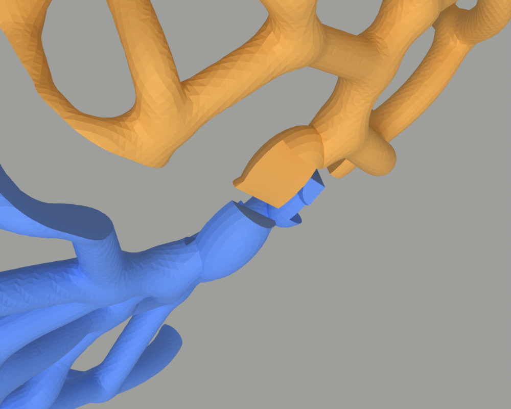

# MRS-01 Modular Recording Shell, printable parts: overlapping joints

This package holds the back shell and the front plate of the MRS-01, split into parts for FDM printing. It comes in two versions for two printer sizes. All parts are already turned into their print orientation.

**Status: nothing in this package has been printed or assembled yet.** The geometry is checked by computer only. Print two neighbouring parts and test the joint before you print the whole set.

## Folders

```
print/overlap/
├── README.md
├── bed-256/            parts for a 256 × 256 × 256 mm printer
│   ├── back-shell/     MRS-01_shell_01.stl ...
│   ├── front-plate/    MRS-01_plate_01.stl ...
│   └── parts.csv       size, volume, joints and neighbours of every part
├── bed-350x320/        the same for a 350 × 320 × 325 mm printer
└── docs/               part maps, exploded view, joint close-up
```

## Which version

| Printer bed | Back shell | Front plate | Joints | Tallest part |
|---|---|---|---|---|
| 256 × 256 × 256 mm (parts kept within 246 mm) | 24 parts | 16 parts | 112 + 33 | 245 mm |
| 350 × 320 × 325 mm (parts kept within 340 × 310 × 315 mm) | 12 parts | 10 parts | 63 + 26 | 305 mm |

The part maps in `docs/` show where every numbered part sits.

## Printing

- **Orientation:** every STL is already rotated and sits on the bed at z = 0. The orientation was chosen by a script for low height, so most struts lie along the layers, and for little overhang. It was not tuned by hand.
- **Supports:** needed on all parts, because the lattice is curved in every direction. Tree supports are a reasonable start.
- **Bed contact:** the parts touch the bed only at a few points. Use a brim.
- **Material and settings:** these are suggestions, not tested values. PETG or ASA rather than PLA, because the whole weight hangs on the stand mount and PLA creeps. 4 walls and 30 to 40 % infill. 0.2 mm layers.
- **Solid volume:** the back shell is about 6136 cm³ and the front plate about 1519 cm³ of solid model volume. Real filament use depends on walls, infill and supports.

## The connection

At every joint the two parts overlap by 10 mm (9 mm on the front plate): one part has a tongue on the outside, the other a tongue on the inside. The step is 0.15 mm clear.

1. At a seam, the lower-numbered part normally lies on the outside. `parts.csv` lists this in the column `lies_outside_of`.
2. Build from the inside out: place the higher-numbered part first, then put the lower-numbered part on from outside.
3. Glue the overlapping faces. They give the largest glue area of the three connection types, but they do not lock sideways, so tape or clamp each seam until the glue sets.
4. Where three parts meet at one strut, the joint is a plain flat face without a step. Glue it as a butt joint.



## Assembly order

1. Start with the part that holds the stand mount: `MRS-01_shell_01` on the 256 bed, `MRS-01_shell_02` on the 350 × 320 bed.
2. Melt the threaded insert into that part before you assemble anything (see below).
3. Add its neighbours, then theirs, working up both sides to the top. `parts.csv` lists the neighbours of every part.
4. Close the shell at the top last. Dry-fit the last three parts together before gluing.
5. Assemble the front plate the same way, starting at the bottom centre.
6. Cut and form the foam inlay (`../../inlay/`) and press it into the shell, with its edge tucked under the lip.
7. Set the front plate onto the foam. Its flange lies on the front face of the lip with a gap of about 0.5 mm. Glue it there with a gap-filling glue if you want it fixed for good.

## Stand mount

- **Part:** one ruthex threaded insert 3/8"-16, 12.7 mm long, 12.6 mm outer diameter.
- **Hole:** 11.9 mm wide and 13.7 mm deep, open to the flat seat on the underside of the mount part. Check the hole size against the ruthex data sheet; 11.9 mm is taken from the product page.
- **How:** heat the insert with a soldering iron and press it in from below until it is flush with the seat.
- **Limit:** the insert is held only by its melted-in grip. Do not lift the shield by its edge while it is on the stand.

## Other things you need

- Glue that suits your filament, for example a two-part epoxy.
- 30 mm soft acoustic foam or felt, about 1230 × 1150 mm, for the inlay.
- A mic stand with a 3/8" thread.

## Full model

The folder `../../full-model/` at the top of the repository holds the unsplit back shell (with the stand mount), the unsplit front plate and the formed inlay. All three are in millimetres and in the same position, so they line up when you load them together. The shell is 800 mm wide.

## Checks that were run

- Every part is a closed solid and fits its bed in the given orientation.
- Neighbouring parts were tested against each other in the assembled position.
  - bed-256, back shell: 56 seams, 3 seam(s) touch too tightly, by up to 0.49 mm: shell_01/shell_12, shell_06/shell_07, shell_18/shell_19. Sand these joints lightly.
  - bed-256, front plate: 30 seams, no interference.
  - bed-350x320, back shell: 23 seams, no interference.
  - bed-350x320, front plate: 17 seams, no interference.

## Known limits

- Nothing has been printed, so fit, strength and the clearances are unproven.
- The front plate has no clips, pins or magnets to the shell. It can be glued to the lip, which then closes the foam in for good.
- There is no opening for a mic rod.
- Where a cut runs through a thin strut, the strut was thickened into a knuckle of about 20 mm so the joint has enough material. On the front plate these are flat pads about 9 mm thick.
- Mirrored parts are not always turned the same way on the bed.
